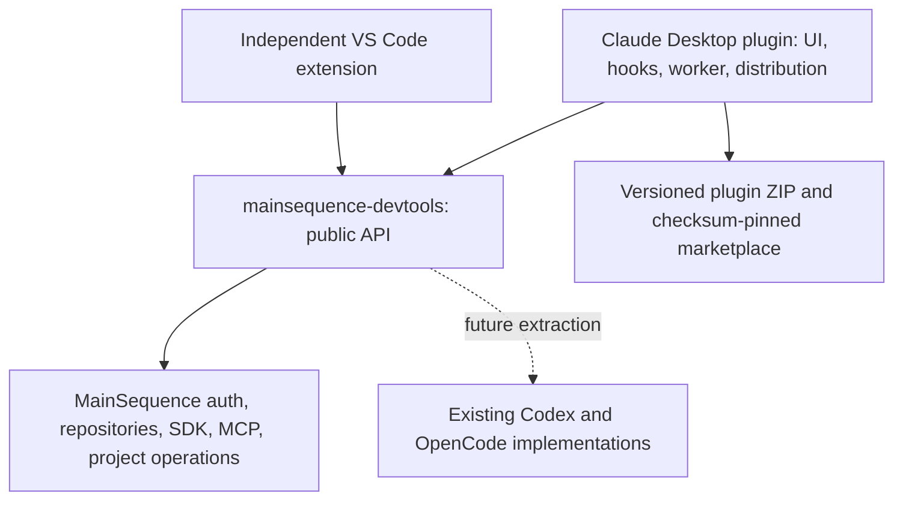

# ADR 0004: Native MainSequence integration for Claude Desktop Code

Status: revised for the approved 0.4.0 layout and removal of Claude account switching.

Amended 2026-10-15: [ADR 0005](0005-user-authored-agent-interactions.md)
records the approved replacement for the Agents-specific automatic introduction
flow described below. That replacement is pending implementation and Desktop
verification; authentication, ownership and launcher placement are unchanged.

## Ownership and dependency direction

All Claude UI, hooks, worker transport, native host adapters, tests, packaging and
marketplace logic lives in `mainsequence-claude-desktop`. Shared authentication,
repositories, project/SDK workflows and MCP behavior comes from the exact published
`@dev-mainsequence/devtools` package. No shared business logic is copied into this
repository and no backend changes are required.

VS Code and other hosts are outside this change. Bundled devtools files are
generated dependency output, not a separately maintained implementation.

## Native UI and transport

One pane contains General, Projects, Current Project, MCP and Activity. Two aligned
navigation rows share one selected section. Native Box, Button, Text, Input, Select,
Svg and Code elements implement the approved grouping without DOM injection. The
pane opens on Desktop session startup without stealing focus. A `SessionMode`
footer hook keeps a branded MainSequence launcher available after the pane closes,
preserving the existing footer tree. `/ms` also opens it on
request. No AbovePrompt hook is registered. Claude controls native placement and
widget chrome; there is no supported custom right-toolbar registration in use.

MainSequence login and workspace settings live in General. Advanced runtime settings
and technical results are collapsed. Activity uses real progress/results and an
explicit empty state. Worker progress is textual, so the implementation does not
invent percentages or reuse fictional preview data.

Native callbacks call `$.process.spawn({argv, cwd, input})`. A bounded JSON envelope
on stdin routes only `devtools` and `projects`; correlated NDJSON carries progress
and results. The removed `accounts` domain is rejected before handler dispatch.
Project controls use no model turn or shell-command parser. The Agents addition
deliberately submits a visible, attributed Claude prompt and serves the agent reply
through a conversation-specific tool. See the [Agents design](../agents.md).
Runtime adapters provide native
folder selection, existing workspace-preference reads, organization lookup through
the public RepositoryClient, and diagnostics; shared operations remain in devtools.

## Authentication and update boundary

MainSequence authentication continues through shared machine-session APIs. Claude
authentication belongs to Claude. The plugin has no credential-slot projection,
Claude OAuth/token reads or writes, account worker, quota/rotation timers, prompt
submission gate or model-turn interception. Existing model-provider settings,
accounts, native credential storage and old profile metadata are retained unchanged.
Unknown plugin-store fields are preserved on settings saves but not interpreted as
Claude account controls. No backend schema, endpoint or configuration changes.

Users upgrading from 0.3.x must start fresh Code sessions to unload old hooks.
There is deliberately no automatic credential migration or attempt to clean up a
running older process. Historical rotator attribution is retained with a clear
removal notice; no account-rotator runtime ships in 0.4.0.

## Validation and remaining host gaps

Tests cover coordinated navigation, shared MainSequence login/renewal/logout,
empty and populated Activity, real cancellation, credential isolation, rejection
of legacy account requests, and public dependency boundaries. Native engine
validation/simulator tests supplement Node tests. ZIP checks verify portability,
checksums, documentation and standalone execution.

Signed native terminals, changing Claude's session root and launching container
sessions remain unsupported. The [verification record](../claude-desktop-verification.md)
distinguishes these limitations and live GUI checks from automated fixture results.
