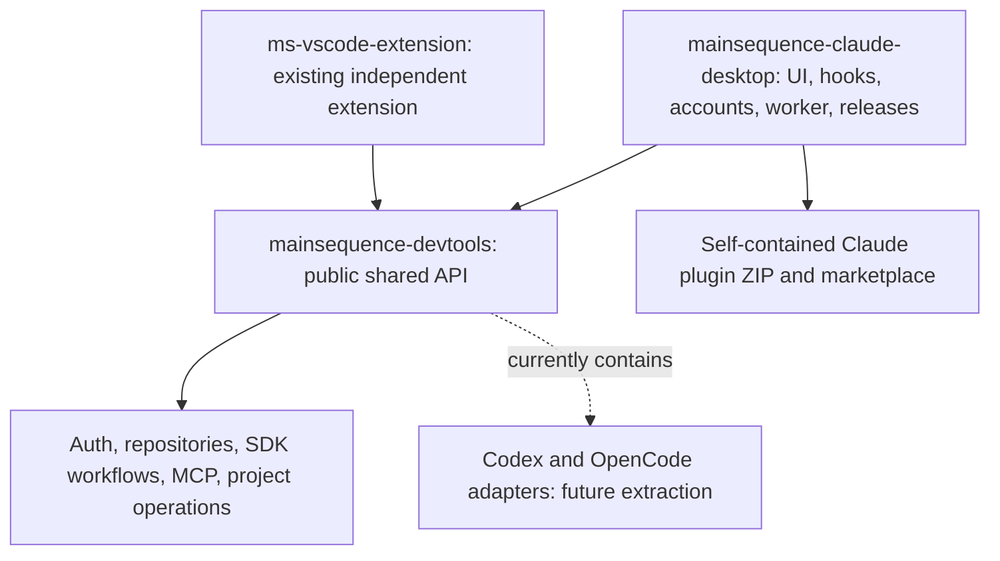

# ADR 0004: Native MainSequence mod for Claude Desktop Code

Status: implemented development adapter; live Desktop/account acceptance tracked
separately in [verification](../claude-desktop-verification.md).

## Decision

Target local Claude Desktop Code using function hooks and native UI elements.
All Claude-specific source is maintained in `mainsequence-claude-desktop`.
It pins the public `@dev-mainsequence/devtools` package and imports only public
exports. Devtools owns reusable MainSequence domain behavior. A generated Claude
plugin bundles that dependency, the native UI, private worker, docs and attribution.
Codex/OpenCode remain in devtools for now; VS Code already has its own repository.

The dependency points toward devtools. Devtools does not import the Claude
repository. Bundled dependency files are generated from the pinned npm package;
they are not a second maintained copy of the shared implementation.

The hook runtime cannot import Node built-ins directly. Native callbacks invoke
`$.process.spawn({argv, cwd, input})`; the child reads a bounded JSON envelope from
stdin and returns correlated NDJSON progress/results. No request is encoded into a
shell command or submitted to a model. The worker routes `devtools`, `projects` and
`accounts` domains. Children receive cooperative cancellation; abrupt termination
reports uncertain effects rather than fabricated rollback.

Native UI modules live in `manifests/claude/hooks`. Functions receiving the engine
`$` object stay in the register module to satisfy the actual loader's static
analysis; presentation/model files remain pure. No DOM access or application-bundle
patching is used. Unsupported native navigation/terminal/container integration is
reported explicitly, with no implicit switch to another coding client.

## Authentication boundaries

MainSequence uses the shared machine-session implementation and scopes credentials
to the selected backend. Claude account profiles are a separate service with native
credential references, atomic metadata transactions and session selection generations.
External model-provider settings are untouched.

The native default Claude credential slot and Desktop's app-managed login are
separate concepts. Sessions start host-managed; automatic rotation and recovery
require an explicit stored-account selection. A saved automatic-mode preference
alone must never select a stored identity for a host-managed session.

The reference rotator selects `CLAUDE_SECURESTORAGE_CONFIG_DIR`. Installed Desktop
code additionally supplies `CLAUDE_CODE_OAUTH_TOKEN` and pushes host token refreshes.
Therefore projection coordinates both values and preserves the original session
values for restoration. It never reports model request identity as verified merely
because environment mutation succeeded. Tokens are read privately by the hook and
are not worker results, mod-store values, logs or model context.

Selection prepares a generation-bound reservation, privately projects the
credential, then confirms that generation. Per-session transitions are serialized;
failure cancels only the matching transition and restores the previous selection.
Other sessions' active or pending reservations prevent credential removal and
replacement. Reservations are released explicitly, including an acknowledged
closed-session cleanup path; elapsed heartbeat time never proves that a suspended
Desktop session has stopped using its account.

Identity and usage are tied to the native access-token fingerprint. A changed token
invalidates previous identity and quota; duplicate or rejected credentials remain
ineligible until resolved. Automatic targets require fresh five-hour and weekly
usage, except an explicitly inapplicable weekly window. Missing weekly data is
unknown, not zero usage.

Usage checks run on manual requests and relevant rate-limit measurement changes;
the periodic heartbeat updates reservation metadata only. Main-session
`classic.StopFailure` events for `rate_limit` and `authentication_failed` can trigger
at most two recovery switches in five minutes after explicit selection and opt-in.
Recovery prepares the next request's account and never replays prompts or tools.
Before prompt submission, the hook reapplies the selected native credential and
blocks submission if that credential is unavailable or expired. Actual host request
ownership remains a separate live acceptance requirement.

Reference usage endpoints and Keychain naming are version-sensitive internals.
Fail safely on malformed/expired credentials and unknown usage; retain attribution
to the pinned upstream revision. Live Desktop ownership/refresh tests remain a
release requirement independent of fixture tests.

## Shared behavior and compatibility

Reuse shared auth, repositories, SDK capabilities, dependency-only sync, MCP and
project locks. Docker, JSONC devcontainer edits and local deletion use devtools' shared
`createProjectOperations` API. The Desktop project adapter only implements native
folder/container callbacks and plugin-specific runtime diagnostics. JSONC changes
preserve user content and use preview digests to reject stale writes. Deletion
checks canonical boundaries and Git/path fingerprints and refuses linked worktrees.
It permanently removes local uncommitted/untracked content only after confirmation
and leaves the remote repository intact. Docker uses validated executable arguments,
repository locks and cooperative cancellation; existing build/Compose devcontainers
are reported unsupported instead of being rewritten as image configurations.

SDK controls follow project capability/status results. Dependency synchronization
does not commit, tag or push, and Python source-version metadata does not enable an
unsupported automatic upgrade. Environment migration is an explicit endpoint-only
project action. Native folder reveal is implemented; signed-terminal opening,
changing the Code session root and launching a container session remain host gaps.

The shared `allowMcpSkills` option now affects capability reporting as well as
dispatch. Its default remains disabled, preserving existing host behavior.

Node is a runtime prerequisite. The exact devtools dependency is bundled at build time. Builds do
not install plugins, sign in to services, publish releases, or mutate user settings.
Documentation and package checks ensure the shipped artifact contains the same
worker, UI, license and compatibility information tested in the repository.

Both repositories are public. Claude source, marketplace and releases share this
repository; the release workflow uses its own repository token. There is no
cross-repository publisher. Plugin version 0.3.1 pins devtools 0.2.2 independently.
The previous 0.3.0 release remains intact. Public dependency updates require
compatibility tests, a lockfile update and a new plugin release.
