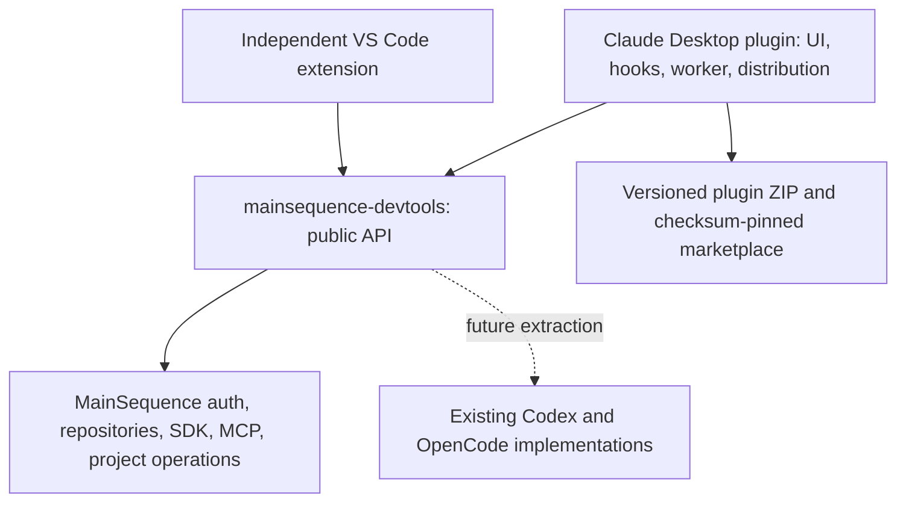
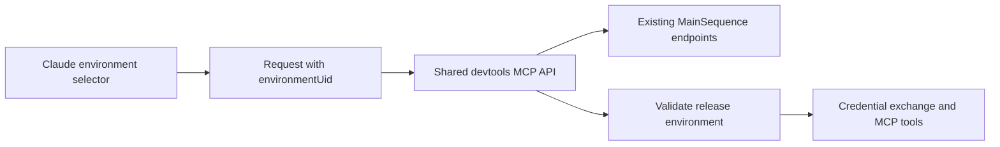

# ADR 0004: Native MainSequence integration for Claude Desktop Code

Status: covers published 0.4.1 workspace defaults and environment-scoped MCP tools,
and the 0.4.2 Agents implementation candidate. Claude account switching remains removed.

## Ownership and dependency direction

All Claude UI, hooks, worker transport, native host adapters, tests, packaging and
marketplace logic lives in `mainsequence-claude-desktop`. Shared authentication,
repositories, project/SDK workflows and MCP behavior comes from the exact published
`@dev-mainsequence/devtools` package. No shared business logic is copied into this
repository and no backend changes are required.

VS Code and other hosts are outside this change. Bundled devtools files are
generated dependency output, not a separately maintained implementation.

## Native UI and transport

The published 0.4.1 pane contains General, Projects, Current Project, MCP and Activity.
The 0.4.2 candidate adds Agents. Two aligned navigation rows share one selected
section. Native Box, Button, Text, Input, Select,
Svg and Code elements implement the approved grouping without DOM injection. The
pane opens on Desktop session startup without stealing focus; `/ms` opens it on
request. No AbovePrompt hook is registered. Claude controls native placement and
widget chrome; there is no supported custom right-toolbar registration in use.

MainSequence login and workspace settings live in General. Advanced runtime settings
and technical results are collapsed. Activity uses real progress/results and an
explicit empty state. Worker progress is textual, so the implementation does not
invent percentages or reuse fictional preview data.

Native callbacks call `$.process.spawn({argv, cwd, input})`. A bounded JSON envelope
on stdin routes only `devtools` and `projects`; correlated NDJSON carries progress
and results. The removed `accounts` domain is rejected before handler dispatch.
Project controls use no model turn or shell-command parser. The Agents addition
deliberately submits a visible, attributed Claude prompt and serves the agent reply
through a conversation-specific tool. See the [Agents design](../agents.md).
Runtime adapters provide native
folder selection, existing workspace-preference reads, organization lookup through
the public RepositoryClient, and diagnostics; shared operations remain in devtools.

## Workspace settings resolution

The Claude adapter calls the public `readWorkspacePreferences` API introduced in
devtools 0.2.3 and retained in the candidate's pinned devtools 0.2.4. The shared
layer resolves only the backend and repositories folder from
existing non-secret configuration; it neither signs in nor writes that configuration.
Claude owns its saved overrides and editable form state.

| Value | Precedence |
| --- | --- |
| Backend | Nonempty saved plugin value; otherwise `MAINSEQUENCE_ENDPOINT`, MainSequence `backend_url`, then `https://api.main-sequence.app`. |
| Repositories folder | Nonempty saved plugin value; otherwise an existing absolute MainSequence `mainsequence_path`, then the user's home `mainsequence` folder. |

The initial form uses concrete defaults while the worker resolves preferences.
Shared devtools actions wait for that resolution. Authentication status is read
separately, so failed login cannot make the default backend disappear. Saved values
and edits made during startup, including folder-picker results, win over late
preference responses. Form edits apply in the current session; Save merges the
known fields into the existing `settings` store, retaining unknown fields.

## MCP environment ownership and enforcement

Claude owns the selector and the per-backend choice in the separate
`mcp-environments` store key. Opening MCP loads authorized environments. No first
or production environment is selected implicitly. A saved choice is revalidated
on startup before its tools are restored; choosing an environment persists it
independently of General's Save button. In the 0.4.2 candidate, Agents shares this
environment selection with MCP; its additional identity and conversation checks
are documented in the [Agents guide](../agents.md).

The public `mcp-environments` action lists environments through the existing backend
endpoint. `environmentUid` scopes discovery and saved connections, and is checked
against the current release before connecting, reading tools or calling a tool.
Disconnect checks the saved connection's environment. Other environments' saved
connections are retained. Since the existing MCP directory API has no environment
filter, shared devtools filters before paginating matching results, with a bounded
scan; it reports a limit error rather than returning a silently incomplete list.
Other hosts retain their prior behavior when they omit the optional environment.

Changing the backend or environment invalidates the current tool map, clears
pending confirmations and cancels outstanding MCP workers. Tool names include the
backend, environment, release and tool identity. A call rechecks the selected
context after confirmation, and late registration responses cannot replace the
new environment's tool map. Cancellation cannot undo a request already completed
remotely.

The native API has no tool-unregister operation. Old names may remain advertised
in an existing session but their handlers refuse execution. A fresh session
registers only the saved, validated environment. This is plugin-local execution
scoping, not a change to backend permissions or to other clients' configurations.

## Authentication and update boundary

MainSequence authentication continues through shared machine-session APIs. Claude
authentication belongs to Claude. The plugin has no credential-slot projection,
Claude OAuth/token reads or writes, account worker, quota/rotation timers, prompt
submission gate or model-turn interception. Existing model-provider settings,
accounts, native credential storage and old profile metadata are retained unchanged.
Unknown plugin-store fields are preserved on settings saves but not interpreted as
Claude account controls. No backend schema, endpoint or configuration changes.

Users upgrading from 0.3.x must start fresh Code sessions to unload old hooks.
There is deliberately no automatic credential migration or attempt to clean up a
running older process. Historical rotator attribution is retained with a clear
removal notice; no account-rotator runtime ships in 0.4.0.

## Validation and remaining host gaps

Tests cover coordinated navigation, shared MainSequence login/renewal/logout,
workspace-default precedence, late responses, environment restoration, stale tool
rejection, switching during confirmation/registration, empty and populated Activity,
real cancellation, credential isolation, rejection
of legacy account requests, and public dependency boundaries. Native engine
validation/simulator tests supplement Node tests. ZIP checks verify portability,
checksums, documentation and standalone execution.

Signed native terminals, changing Claude's session root and launching container
sessions remain unsupported. The [verification record](../claude-desktop-verification.md)
distinguishes these limitations and live GUI checks from automated fixture results.
