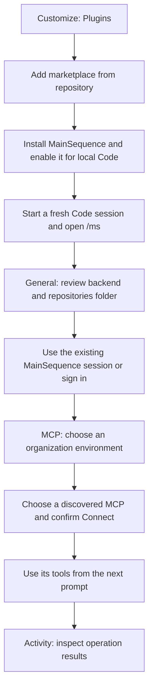

# First run in Claude Desktop Code

This walkthrough covers the published **0.4.1 preview**. It targets a local Code
session in Claude Desktop. Node 22+ must already be installed; MainSequence does
not install it for you. macOS with Desktop's bundled Code 2.1.295 is the recorded
native test environment. See [verification](claude-desktop-verification.md) for
what has and has not been checked on a live Desktop window. The source-only
[0.4.2 candidate](agents.md) also includes Agents; that section is not part of the
published 0.4.1 walkthrough below.

## Follow the setup flow

This diagram is a navigation map, not a screenshot of Claude Desktop. Native
screenshots are pending live GUI verification; button placement can vary by build.

## 1. Install and open the pane

1. In Claude Desktop, open **Customize → Plugins → Add marketplace → Add from repository**.
2. Paste `https://github.com/mainsequence-sdk/mainsequence-claude-desktop.git`.
3. Install **MainSequence** from **mainsequence-desktop** and enable it for a local Code session.
4. Start a fresh Code session. The MainSequence pane opens without taking keyboard focus.
   If it is closed, enter `/ms` to reopen it.

You should see **General**, **Projects**, **Current Project**, **MCP** and **Activity**.
The selected section controls the contents of the pane. There is no account-switching
page or launcher strip above the chat. Existing installations should follow the
[update instructions](claude-desktop-distribution.md#update-an-existing-installation).

## 2. Review General before signing in

The **Workspace settings** card shows actual editable values:

| Setting | Value when no override exists | What to do |
| --- | --- | --- |
| Backend URL | `https://api.main-sequence.app` | Use the backend assigned to your organization. Existing plugin settings, environment configuration and MainSequence preferences take precedence. |
| Code repositories folder | Your home directory followed by `mainsequence`, displayed as a full path | Keep it, edit it, or use **Choose folder**. An existing saved folder takes precedence. |

Wait for **Loading workspace settings…** to finish. You can use the displayed
values immediately afterward without pressing Save. Edits apply to this session;
**Save settings** keeps them for future sessions. Initialization does not overwrite
saved settings or edits you have just made. The [settings guide](claude-desktop.md#general-mainsequence-login-and-settings)
explains the exact precedence.

If an existing MainSequence session is available, General displays its status.
Use **Check connection** to verify it. Otherwise choose **Sign in with browser**
and complete the MainSequence authorization page. This signs in to MainSequence;
Claude's model account and provider configuration remain managed by Claude.

## 3. Select an environment and connect an MCP

1. Open **MCP**. Wait for the organization environments to load; **Refresh environments** retries the request.
2. Choose the intended **Environment**. Check the **Active environment** label before connecting anything.
3. In **Find project MCPs**, choose a discovered MCP. Use search or **Next page** if needed.
4. Choose **Connect selected MCP** and review the confirmation before accepting it.
5. The connection appears in **Connected MCPs**. Use **View tools** to inspect its tools.
   **Refresh Claude tools** retries tool registration if needed.

Only the selected environment's connections are shown and its tools can run.
Every connection label includes its environment. The selection is remembered per
backend automatically; General's Save button is not required for this choice.
Connections in other environments remain saved.

Registered tools are available from the next prompt. Claude requests confirmation
before each MainSequence MCP tool call, naming the environment. The Tool explorer
also lets you enter a tool name and JSON object arguments, then **Review and call tool**.

Changing environments clears pending confirmations and blocks old tools immediately.
Claude may still advertise old tool names in an existing session because the mod
API cannot unregister them. Start a fresh Code session to remove those stale names;
only the saved, validated environment's tools are restored.

## 4. Check the result

**Activity** records operations from the current session, their status and real
progress messages. Expand an operation for details. An empty Activity section means
no visible operation has been recorded in that session. Cancelling a running worker
does not undo effects that have already happened.

To set up a repository, use **Projects**; to manage a selected local project, use
**Current Project**. Their [feature guide](claude-desktop.md#projects-and-current-project)
lists prerequisites and host limitations.

## If a step does not work

| What you see | Next step |
| --- | --- |
| No MainSequence pane | Check that the plugin is enabled in a local Code session, start a fresh session, then enter `/ms`. |
| Worker or Node error | Open **General → Advanced → Runtime & diagnostics**. Configure an absolute Node 22+ executable path if Desktop cannot locate Node. |
| Sign-in or connection failure | Check the backend URL in General and inspect the reported error. Use **Check connection** before retrying the operation. |
| No environments | Verify MainSequence login and the backend URL, then choose **Refresh environments**. The account may have no authorized environments; none is selected automatically. |
| No MCPs in the chosen environment | Clear the search and choose **Find project MCPs**. Another environment's saved connections remain hidden while this one is selected. |
| An old tool is refused after switching | Use a tool from the active environment. Start a fresh Code session if stale advertised tool names are confusing. |
| The old plugin version remains | Follow [refresh, update and verify](claude-desktop-distribution.md#update-an-existing-installation). `/reload-plugins` does not download releases. |

See the [full guide](claude-desktop.md), [distribution guide](claude-desktop-distribution.md)
and [verification record](claude-desktop-verification.md) for details.
